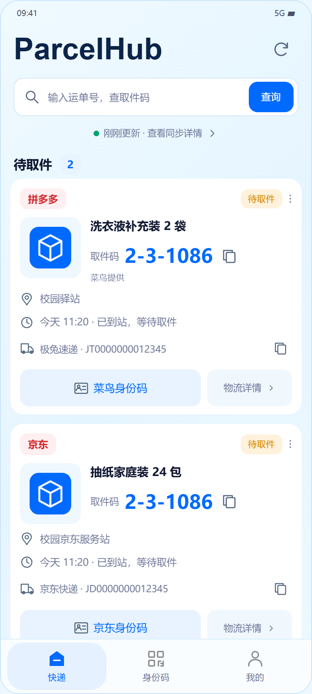
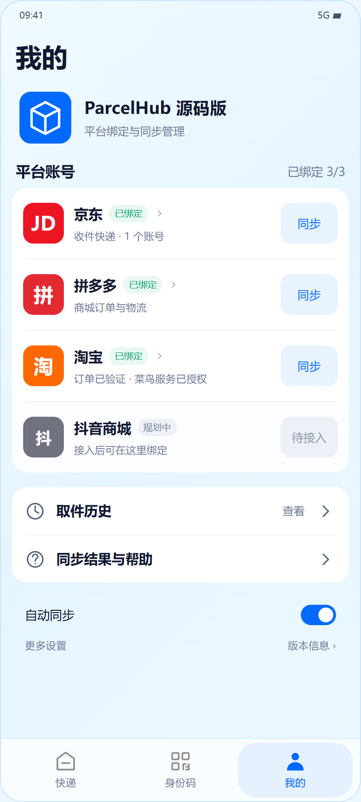
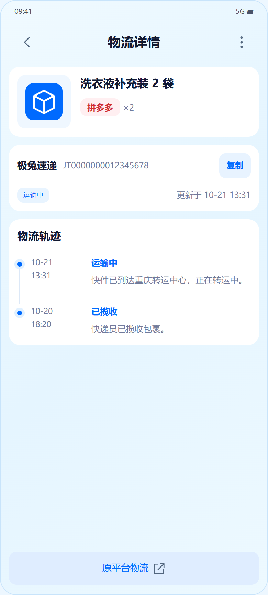
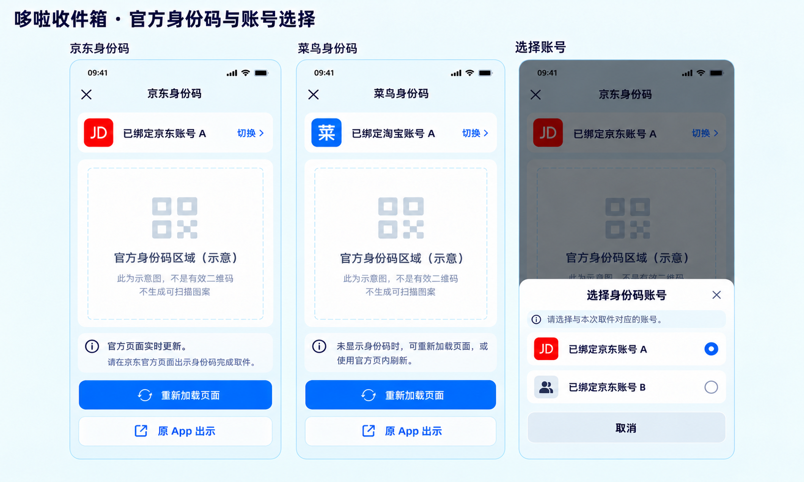

# ParcelHub / 哆啦收件箱 · 源码版

基于 Android 的个人包裹聚合工具。本目录从 `v0.9.7-personal`（versionCode 27）整理为独立源码快照，保留平台绑定、同步、物流与取件信息等实现，并移除个人资料与未确认可再分发的人物素材。源码版应用显示为“ParcelHub 源码版”。

**源码公开，非商业使用依许可免费，商业使用本项目有权授权的新增部分须事先取得明确书面许可。** 可免费授权、收费授权或协商合作。整体属于 source available，非 OSI 意义的开源；上游 MIT 等代码继续依原许可，商业权利不因本项目条款缩减。详见 [许可范围](LICENSE_SCOPE.md)、[商业授权](COMMERCIAL-LICENSING.md)和[第三方归属](THIRD_PARTY_NOTICES.md)。

## 功能与入口

- 京东、淘宝/菜鸟、拼多多绑定与多账号管理；通过官方网页会话读取本人可访问的信息。
- 包裹分类、商品图片、物流详情、取件码及身份码入口；平台来源与取件码服务来源分别处理。
- 历史范围默认 7、最大 180 自然日；扩展范围会触发所选范围的补读，待取/运输中包裹有独立展示策略。
- 本地手动/分享文本导入、同步覆盖记录和异常提示。当前版本已移除通知监听导入，不把收费快递查询或短信作为默认主数据源。

实现位置、具体行为及官方网页链接见 [核心功能与网址入口](docs/IMPLEMENTATION.md)。源码中保留的上游设置、AI、组件和辅助服务不代表所有旧功能都经过本版本重新验收。

## 核心 UI 与功能图解

只展示四类核心界面，包含“我的”页。下图是**设计示例，不是运行截图或真实账号数据**；沿用已确认的蓝白布局，公开展示版替换人物素材、商品图等，不以配图证明扫码、绑定或同步已通过真机验收。详细介绍见[软件与核心 UI 图解](docs/FEATURES.md)。

<table><tr><th>首页：聚合待取包裹</th><th>我的：绑定与同步管理</th></tr><tr><td></td><td></td></tr></table>

**物流详情**：查看承运商、运单与状态时间线。**身份码**：进入对应官方取件服务并选择账号，图中的码区域为无效占位。





## 下载加固版（约 7.5 MiB）

使用已发布的 **v0.9.7-personal-protected / versionCode 27**，不是新构建的 Debug 包：

- [GitHub Release 下载页](https://github.com/Saiyan-hl0408/dora-inbox/releases/tag/v0.9.7-protected) · [直接下载加固 APK](https://github.com/Saiyan-hl0408/dora-inbox/releases/download/v0.9.7-protected/ParcelHub-v0.9.7-protected.apk)
- 备用：[公开下载站](https://dora-inbox-hl0408.bouncytiger1.chatgpt.site) · [站点直链](https://dora-inbox-hl0408.bouncytiger1.chatgpt.site/downloads/ParcelHub-v0.9.7-protected.apk)
- 大小 **7,887,482 字节**（7.52 MiB）；SHA-256：`85c1235d6b273b693097ddc3d82bd8e3a378c6b3921523af645f505351111e5b`。
- Android 10+；包名 `com.songoku.parcelhub`。校验和、分发说明见 [DOWNLOADS.md](DOWNLOADS.md)，Release 同时附第三方声明。

加固 APK 是既有个人版发布产物，不是本源码快照构建产物。它保留原版界面；源码版替换素材并使用独立包名，两者签名、配置和加固过程也有差异，不承诺逐字节复现。未提供人物素材、品牌、签名密钥或平台商业服务的额外授权。

## 从源码构建

Android 10+（minSdk 29），SDK platform 36 / build-tools 36.0.0，JDK 17 或 21，Gradle wrapper 8.13，AGP 8.13.2，Kotlin 2.2.20。

```sh
./gradlew --no-daemon :app:assembleDebug :app:testDebugUnitTest
```

Windows 可使用 `gradlew.bat`，或运行 `tools/build.ps1`，通过 `ANDROID_HOME`、`JAVA_HOME` 或参数指定 SDK/JDK。完整步骤、国内镜像策略、Windows 临时目录问题、输出位置及签名边界见 [BUILDING.md](BUILDING.md)。

## 公开版差异与验证

源码版使用 `com.songoku.parcelhub.source`，版本 `0.9.7-source`，避免覆盖原个人版。菜鸟站点默认空，需用户在“我的”设置自己的官方站点链接；没有默认全国查询权限。人物图标、字标、个人头像、群号和收款码不随源码公开；对应视觉改为中性包裹资源/公开 GitHub 联系入口。原开发目录和原 APK 未修改。详见[导出差异](docs/EXPORT-CHANGES.md)与[验证记录](docs/VALIDATION.md)。

构建和合成单元测试不能证明真实账号登录、短信/QQ/原 App 授权、会话恢复、实际同步或 Xiaomi/HyperOS 真机权限已验收。官方页面/接口可能变化，网页可访问也不等于平台授予商业服务权限。
